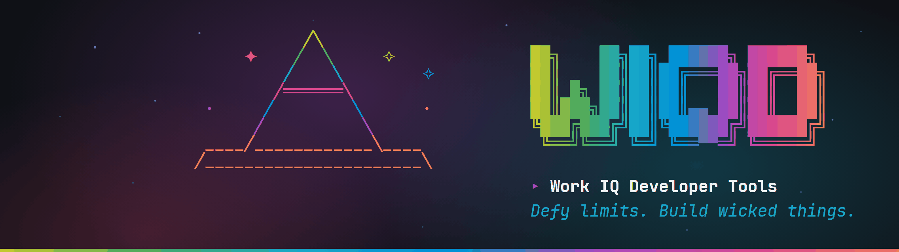

# Work IQ Dev Tools - The agentic experience for Microsoft 365 Copilot plugins

[](https://www.npmjs.com/package/@microsoft/wiqd)

<p align="center">
  
</p>

<p align="center">
  <strong>⚠️ Pre-release preview.</strong> Work IQ Dev Tools are experimental software shared for experimentation purposes only. They are not production-ready and are not officially supported. Expect breaking changes.
</p>

**WIQD (Work IQ Dev Tools) is the agentic experience for the end-to-end Microsoft 365
Copilot plugin lifecycle: build, improve, preview, and publish.** A plugin is the
app package you ship. Skills, connectors, and declarative agents are components
you compose into it; a declarative agent adds a conversational experience when
you need one, but is not required for every plugin. Work conversationally with
WIQD or run the same lifecycle commands directly in your terminal and CI.

> This repository hosts Work IQ Dev Tools' documentation, downloads, and project meta-files. The `wiqd` CLI itself is publicly available via npm — see the [Quick start](#quick-start) below to install it — while its source remains private to Microsoft during this preview.

## What you can do with Work IQ Dev Tools

- **Create and compose plugins** — start with a plugin, then add skills, connectors, and an optional declarative agent.
- **Validate before you ship** — catch manifest and reference errors in your editor or from the terminal, with both static and deep validation modes.
- **Improve with guided help** — ask WIQD to explain validation findings and help repair plugin components.
- **Package and provision** — produce a distributable app package and deploy it to a Microsoft 365 environment with a single command.
- **Share or publish** — grant users or your tenant access, or submit the plugin to your organization app catalog for administrator approval.
- **Evaluate agent components** — run quality evals when your plugin includes a deployed declarative agent; this is not whole-plugin validation.

## The primary experience: plugin, workflows, and guided journeys

WIQD's primary experience is a **coding-assistant plugin** for GitHub Copilot CLI
or Claude Code. Its guided workflows help you compose, validate, improve, preview,
and deliver your Microsoft 365 plugin. The WIQD marketplace plugin is the guide;
the Microsoft 365 app package it helps you build is the deliverable. These are
different artifacts, not two names for the same plugin.

You talk to the experience in natural language:

```text
"create a plugin with a triage skill and a declarative agent"
"add an MCP connector to my plugin"
"validate my plugin and help me fix the findings"
"provision, package, and share my plugin with my team"
```

WIQD routes these requests to the plugin-authoring and lifecycle workflows.
Agent-specific workflows remain available for conversational components and
existing `wiqd agent` projects; they are not prerequisites for skill-only or
connector-only plugins.

Browse the full command surface in the [CLI Reference](https://aka.ms/wiqd/docs?id=cli/reference).

## Key highlights

| Highlight                   | What it gives you                                                                                |
| --------------------------- | ------------------------------------------------------------------------------------------------ |
| **Full plugin lifecycle**   | Create, compose, validate, provision, package, share, and submit plugins to your tenant catalog. |
| **Guided workflows**        | Natural-language authoring, validation, troubleshooting, preview, and delivery.                  |
| **Editor-grade validation** | Built-in Language Server Protocol support gives real-time manifest validation in VS Code.        |
| **Extensible**              | Add commands, validation providers, and health checks via npm-based extensions.                  |
| **Automation-ready**        | Run lifecycle commands directly in scripts and CI.                                               |
| **Quality evaluation**      | Run YAML-defined eval suites against deployed declarative-agent components.                      |

## The CLI

The `wiqd` CLI powers the plugin lifecycle and doubles as an automation surface
for scripts and CI. Guided file editing and platform approval steps are not
promises of an equivalent CLI command.

A pocket-sized command set:

```powershell
wiqd plugin create --name my-plugin
cd my-plugin
wiqd plugin add skill --name "Triage Issues"
wiqd plugin add agent
wiqd plugin validate --env dev
wiqd auth login --interactive
wiqd plugin provision --env dev
wiqd plugin package --env dev
wiqd plugin validate --mode deep --env dev
wiqd plugin share --scope users --email teammate@contoso.com --env dev
```

The full command tree — every option, exit code, and JSON output schema — lives in the [CLI Reference](https://aka.ms/wiqd/docs?id=cli/reference).

## Quick start

```powershell
# Windows
iex "& { $(irm 'https://aka.ms/wiqd/install.ps1') }"
```

```bash
# macOS / Linux
curl -fsSL https://aka.ms/wiqd/install.sh | bash
```

The installer sets up the `wiqd` CLI with its bundled lifecycle backend and
optional editor/host integrations. See
[Installation](https://aka.ms/wiqd/docs?id=getting-started/installation/) for
prerequisites and platform-specific setup.

For marketplace-first guided authoring in GitHub Copilot CLI:

```text
copilot plugin install wiqd@awesome-copilot
```

Or in Claude Code:

```text
claude plugin marketplace add microsoft/wiqd
claude plugin install wiqd@wiqd
```

Start a new host session. Marketplace installation supplies the guide, not the
`wiqd` CLI; install the CLI separately before running direct validation or
tenant lifecycle commands. In GitHub Copilot CLI:

```bash
copilot -i "create a plugin with a triage skill and a declarative agent" --agent wiqd:wiqd
copilot -i "validate my plugin in dev and help me fix the findings" --agent wiqd:wiqd
copilot -i "provision and share my plugin with my team using dev" --agent wiqd:wiqd
```

Follow the [Quickstart](https://aka.ms/wiqd/docs?id=getting-started/quickstart/) for the step-by-step walkthrough, or see [Installation](https://aka.ms/wiqd/docs?id=getting-started/installation/) for options and troubleshooting.

## Common workflows

### Compose your plugin

```powershell
wiqd plugin create --name my-plugin
cd my-plugin
wiqd plugin add skill --name "Triage Issues"
wiqd plugin add agent
```

Add a connector, or configure the optional agent component, conversationally:

```text
"add an MCP connector to my plugin"
"add web search to the declarative agent in my plugin"
```

See [Build a Plugin](https://aka.ms/wiqd/docs?id=getting-started/build-a-plugin/).

### Validate, fix, and package

```powershell
wiqd plugin validate --env dev
wiqd plugin provision --env dev
wiqd plugin package --env dev
wiqd plugin validate --mode deep --env dev
```

Static validation checks the declarative-agent surface, not the entire plugin.
Provision before packaging; deep validation needs the built ZIP. The plugin
command tree is alpha and enabled by default.

### Share with users or your tenant

```powershell
wiqd plugin share --scope users --email teammate@contoso.com --env dev
wiqd plugin share --scope tenant --env dev
```

Sharing grants direct access. For organization-catalog discovery, run
`wiqd plugin publish --env dev` and obtain tenant administrator approval. Public-store
submission and certification remain separate Partner Center steps.

### Improve a declarative-agent component

```powershell
wiqd agent eval --env dev                 # run quality evals
```

Follow [agent evaluation](https://aka.ms/wiqd/docs?id=cli/reference#wiqd-agent-eval)
to target the deployed agent. Agent evaluation is not whole-plugin validation;
monitoring availability depends on your installed extensions and access.

## Where to go next

- [Getting Started](https://aka.ms/wiqd/docs?id=getting-started/) — installation, authentication, and your first plugin.
- [Build a Plugin](https://aka.ms/wiqd/docs?id=getting-started/build-a-plugin/) — the full composition and delivery walkthrough.
- [CLI Reference](https://aka.ms/wiqd/docs?id=cli/reference) — every command, option, and exit code.
- [Copilot workflows](https://aka.ms/wiqd/docs?id=cli/reference) — the guided workflows available through the plugin, mapped to their CLI commands.
- [Installation & troubleshooting](https://aka.ms/wiqd/docs?id=getting-started/installation/) — install options, custom flags, and common fixes.

## Contributing

The wiqd CLI is publicly available; its source is private to Microsoft during this preview. See [Contributing](CONTRIBUTING.md) for how to report issues, request features, and reach the team — the short version: run `wiqd feedback submit` from the CLI.

## Telemetry

wiqd collects anonymous usage telemetry — [OpenTelemetry](https://opentelemetry.io/) spans for the commands you run — to help improve the product. Telemetry is **on by default** with a one-time first-run disclosure, flows through a single disclosed channel, and has a single, unified opt-out. When telemetry is disabled, the pipeline is never constructed and **no telemetry network calls are made** (including the background version-check ping).

To turn it off, use any one of the following:

```powershell
# Persisted config — applies to all future runs
wiqd config set telemetry=false

# Environment variable (canonical) — PowerShell
$env:WIQD_TELEMETRY = "0"

# Environment variable (canonical) — bash / zsh
export WIQD_TELEMETRY=0

# Or the standard DO_NOT_TRACK convention
export DO_NOT_TRACK=1
```

Accepted opt-out values for `WIQD_TELEMETRY` are `0`, `false`, `no`, or `off` (case-insensitive). The legacy alias `WIQD_TELEMETRY_DISABLED=true` also works. See the [Telemetry documentation](https://aka.ms/wiqd/docs?id=project/telemetry/) for exactly what is collected and the full opt-out precedence rules.

## Trademarks

This project may contain trademarks or logos for projects, products, or services. Authorized use of Microsoft trademarks or logos is subject to and must follow [Microsoft's Trademark & Brand Guidelines](https://www.microsoft.com/en-us/legal/intellectualproperty/trademarks/usage/general). Use of Microsoft trademarks or logos in modified versions of this project must not cause confusion or imply Microsoft sponsorship. Any use of third-party trademarks or logos are subject to those third-party's policies.

## License

wiqd is licensed under the [MIT License](LICENSE). See the `LICENSE` and `NOTICE` files distributed with wiqd for the full license text and third-party attributions.

Copyright (c) Microsoft Corporation. All rights reserved.
