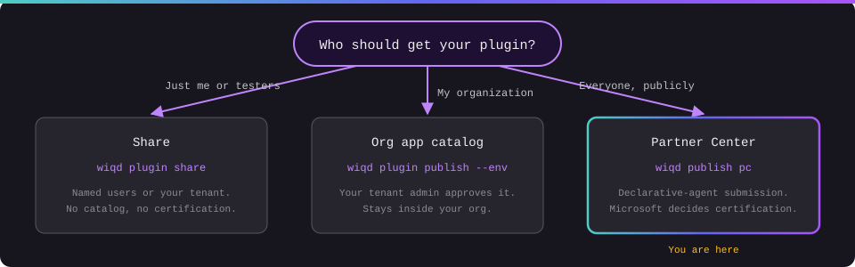

# Publish to Partner Center

You've built your declarative agent and tried it with early users. Now you want everyone to be able to find it. `wiqd publish pc` takes your supported declarative-agent package from your project folder to Partner Center. It creates the offer, fills in the Draft, uploads your package, logo, and screenshots, and, with separate authorization, sends it to certification. Use status to follow progress; acceptance is not a guarantee of certification or Live publication. Standalone skill/connector-only plugins still use portal submission.

**wiqd prepares, uploads, submits, and tracks your offer. Partner Center verifies your account and certifies your plugin.**

## How it works


1. **Enroll and get verified** in Partner Center. This happens in the portal, not in wiqd.
2. **Sign in** with `wiqd auth login --interactive`. The first time, this creates `partner-center.json` in your project.
3. **Fill in your offer details** with `wiqd publish pc init`, then replace the placeholders.
4. **Check everything** with `wiqd publish pc preflight`. It doesn't change anything.
5. **Prepare the Draft** with `wiqd publish pc prepare --yes`.
6. **Submit for certification** with `wiqd publish pc submit --product-id product/<GUID> --yes --interactive`. You type `submit` to confirm.
7. **Track it** with `wiqd publish pc status`.
8. **Find it in the Agent Store** once it's certified and Live.

In short: **enroll → sign in → init → preflight → prepare → submit → status → Agent Store**.

## Prerequisites

### a. Your Partner Center account is enrolled and verified

:::caution[Start this first]
Enrollment includes legal and organizational verification by Microsoft and can take several business days. Kick it off before you finish building, so it isn't the thing holding up your launch.
:::

**Before you begin, you need:**

- Authority to sign legal agreements on your company's behalf
- Your company's legal business name, address, and primary contact. Microsoft verifies these.
- A Microsoft Entra ID work or school account

**Pick your starting point:**

| Your situation | What to do |
| --- | --- |
| No Partner Center registration yet | Sign up for a new account with your work or school account. |
| Already in another Partner Center program with a work account | Reuse that account, or create a new one. |
| Registered with a personal Microsoft account | Associate your Entra work account with the existing seller account. |
| Existing Office developer on a personal Microsoft account | Associate your work account, or keep the existing Office developer account. |

**Enroll in the Microsoft 365 and Copilot program:**

- **New to Partner Center:** go to the [Partner Center enrollment page](https://partner.microsoft.com/dashboard/account/v3/enrollment/introduction/office) and sign in with your work account. Complete the publisher profile (company, publisher, and contact info), then accept the Microsoft Office Agreement. If you're new to the program, you'll also accept the Microsoft AI Cloud Partner Program Agreement.
- **Already a partner:** go to **Settings > Account settings > Programs > Microsoft 365 and Copilot > Get Started**. Pick or create a publisher under **Identifiers > Publisher** (you need the Owner role on an existing publisher), then accept the Microsoft Publisher Agreement.

**Confirm you're verified and ready:**

- [ ] Verification shows as complete in **Settings > Account settings** (legal info, publisher, and contact)
- [ ] **Microsoft 365 and Copilot** shows as registered under **Settings > Account settings > Programs**
- [ ] Whoever runs `wiqd publish pc` has a seller role that can create and submit offers. See [Roles and permissions](https://learn.microsoft.com/partner-center/account-settings/permissions-overview).
- [ ] You know your **seller tenant GUID**. You'll pass it to `wiqd auth login --tenant`.

Want the setup links in your terminal? Run:

```bash
wiqd publish pc access
```

It's read-only. It doesn't sign in or call any service, so it can't tell you what's missing. Its readiness is always `unverified`.

More on Microsoft Learn: [Open a developer account](https://learn.microsoft.com/partner-center/marketplace-offers/open-a-developer-account) · [Manage account settings and profile](https://learn.microsoft.com/partner-center/marketplace-offers/manage-account-settings-and-profile) · [Add new publishers](https://learn.microsoft.com/partner-center/marketplace-offers/add-new-publishers-to-office-store-program)

### b. wiqd is ready

1. **Use a public release containing direct publishing.** The launch branch targets `@microsoft/wiqd` **0.25.0**. Check `wiqd --version`, `wiqd doctor`, and `wiqd publish pc --help`; the version alone does not prove that your installed artifact contains this capability or that rollout is complete. See [Installation](/getting-started/installation/).
2. **The Partner Center commands are on by default in the public launch build.** `wiqd ext list` shows `microsoft.marketplace` as `active`. Explicit removal or a disabled `partner-center-publishing` flag is preserved. If you deliberately want to restore the bundled extension or re-enable the flag:
   ```bash
   wiqd ext add microsoft.marketplace
   wiqd config flags set partner-center-publishing true
   ```
3. **The wiqd EULA is accepted.** Any real (non-`--mock`) run needs it.
   If the extension is not bundled, install the approved public release rather than switching to an internal package. Portal submission remains an alternative.
4. **Sign-in works on your machine.** Windows prefers WAM when available. Browser sign-in, and any non-Windows machine, needs Microsoft Edge and a free local port 8400. Protected OS storage through `keytar` is required; Linux also needs a working libsecret keyring. There is no plaintext fallback.

### c. Your plugin project is ready

1. **Your plugin is built and previewed.** See [Build a plugin](/getting-started/build-a-plugin/).
2. **Your saved source validates:** `wiqd plugin validate --mode source --path . --env local`
3. **`appPackage/manifest.json` has a `name.short`.** That's your default offer title.
4. **Listing images are inside the project folder:** a logo and 1 to 5 screenshots, each non-empty, 200 MB or smaller, and not behind a symlink.
5. **You have your listing details:** a privacy policy URL, an `https://` support page, terms (`standardMicrosoft` or your own), and release notes for reviewers (1 to 2,500 characters). Decide whether your plugin needs a separate service purchase or has in-app purchases. Partners have to answer this one explicitly.
6. **Your project is in a local folder that isn't synced.** wiqd keeps a lock in `.wiqd/partner-center/`, and OneDrive can break it (`PC_RESERVATION_LOST`).

## Path 1: Publish it conversationally

Open GitHub Copilot CLI in your plugin project and tell wiqd what you want. It runs the checks, explains what it finds, and stops for your OK before anything changes in Partner Center.

### What to say

> "Help me publish this plugin using `wiqd publish pc`" · "Publish my plugin to Partner Center" · "Check my Partner Center submission" · "Why did certification fail?"

:::tip[Let the agent do it for you]
Paste this into Copilot CLI from your plugin project folder:

```text
Help me publish this plugin to Partner Center using wiqd publish pc.
Check my setup first, then walk me through partner-center.json.
Run source validation, build one final ZIP, and require package validation to pass on that exact ZIP.
Explain Marketplace policy findings as advisory, not blockers.
Pass the same ZIP with --package and the approved --release-notes to preflight and prepare.
Ask me before prepare, then hand me the submit command to run myself.
For an existing or rejected offer, preview explicit update selectors, ask before applying,
and guide me to review and submit the updated Draft in Partner Center.
```
:::

### Walkthrough

| You say | wiqd does |
| --- | --- |
| **"Publish this plugin to Partner Center."** | Checks that `publish pc` is on, and that you're in a plugin project with a `name.short`. |
| | Asks **you** to run `wiqd auth login --interactive --tenant <seller-tenant-guid>`. Sign-in is yours. |
| | Runs `wiqd publish pc init`. It never prints your hide key. |
| **"Help me fill it in."** | Walks you through each placeholder in `partner-center.json`: title, description, categories, legal URLs, logo, and screenshots. |
| **"Is it ready?"** | Runs source validation, builds a final ZIP, requires package validation to pass, then runs preflight with that same `--package` and approved `--release-notes`. Marketplace policy findings are advisory. |
| **"Looks good, prepare it."** | For a fresh offer, runs `wiqd publish pc prepare --yes` with that exact ZIP and release notes after your OK, and shows you what it uploaded. Existing/rejected offers use [update](#update-an-existing-or-rejected-offer). |
| | Hands you the exact `submit` command. **You** run it and type `submit`. |
| **"Where's my submission?"** | Runs `wiqd publish pc status` and explains where it is. |

### Two ways to run it

| | Ask the agent | Run it yourself |
| --- | --- | --- |
| Best for | Your first submission, or figuring out what's missing | Repeat submissions and pipelines |
| Sign-in | You run it | You run it |
| Draft changes | Agent asks, then runs `prepare --yes` | You run `prepare --yes` |
| Submission | You run `submit` and type `submit` | You run `submit`, or use `--authorize-submit` in CI |

## Path 2: Use the CLI directly

Run these from your plugin project folder:

```bash
# 1. Sign in (creates partner-center.json the first time)
wiqd auth login --interactive --tenant <seller-tenant-guid>

# 2. Add the missing sections to partner-center.json, then replace every placeholder
wiqd publish pc init
#    or link an offer that already exists
wiqd publish pc init --product-id product/<GUID>

# 3. Validate saved source, build once, then validate the exact upload ZIP
wiqd plugin validate --mode source --path . --env local
wiqd plugin package --path . --env local --output ./release.zip
wiqd plugin validate --mode package --package-file ./release.zip --json

# Continue only when package validation reports PASSED.
wiqd publish pc preflight --package ./release.zip --release-notes "First release." --json

# 4. Create the offer, fill in the Draft, and upload the package, logo, and screenshots
wiqd publish pc prepare --package ./release.zip --release-notes "First release." --yes --json

# 5. Send it to certification (you'll type "submit")
wiqd publish pc submit --product-id product/<GUID> --yes --interactive --json

# 6. Follow progress
wiqd publish pc status --job-id <job-id> --watch
```

Save the `productId` from `prepare` and the `jobId` from `submit`. You'll need them for the next steps.

**Want one command?** After validating the ZIP, `wiqd publish pc --package ./release.zip --release-notes "First release." --interactive` runs preflight, prepare, and submit in order, and stops at the first failure. Use it only for a fresh offer, not an update.

**Just trying it out?** `wiqd publish pc preflight --mock --json` returns sample results without reading your project or calling Partner Center.

:::note[Two confirmations, on purpose]
`--yes` OKs changes to your Draft. Submitting needs a second OK: `--interactive` (you type `submit`) or `--authorize-submit` (unattended, for pipelines). Pick one, not both.
:::

:::note[Submitted isn't published]
`submit` returns `published: false`. That's expected. `published` is only `true` once wiqd sees the offer Live. Use `pc status` to check, and don't rerun `submit`. A repeat `submit` reports on the original submission and won't double-submit.
:::

**Which package goes out?** Keep the validated ZIP unchanged and pass it explicitly to both commands. Without `--package`, `preflight` and `prepare` each build fresh bytes from `--package-env` (default `local`); these are not automatically the ZIP you validated. Revalidate whenever the ZIP changes. Marketplace policy checks are advisory; package validation passing is the hard gate, not a certification guarantee.

### Marketplace authentication in automation

`--authorize-submit` is consent for this invocation, **not an authentication method**.
Marketplace does not consume the core pipeline inputs `CI_ENABLED`,
`M365_ACCOUNT_NAME`, `M365_ACCOUNT_PASSWORD`, or `M365_REFRESH_TOKEN`. The
[core CI/CD authentication examples](/getting-started/ci-cd-authentication/)
do not sign in this extension. There is no supported clean-runner,
service-principal, or workload-identity bootstrap for Marketplace in this build.

On a trusted persistent runner, first sign in interactively as the same OS user
that will run the job, from the intended project:

```bash
wiqd auth login --interactive --tenant <seller-tenant-guid>
```

Complete seller/binding confirmation, accept the WIQD EULA through its supported
flow, and retain access to that user's protected OS credential store. An
interactive desktop session succeeding does not prove a runner service can
unlock that store. Do not copy caches or export credentials as artifacts.
Preserve the intended project's binding and receipts securely.

After independent package validation and explicit submission approval, that
runner can use:

```bash
wiqd publish pc --path ./agent-project --package ./release.zip --release-notes "Approved release." --authorize-submit --json
```

Here `release.zip` is inside the selected project. Commands silently acquire
separate Graph and Marketplace tokens from the saved session and recheck
publisher identity. If interaction is required, stop and have the publisher
sign in again in a real terminal under that runner identity. Do not call
`auth login` in CI or automatically retry an uncertain mutation.
Ephemeral hosted runners without such a session should validate/package in CI
and hand off publishing to an authenticated operator. No live pipeline
acceptance is implied by these instructions.

## After you submit

1. **Wait for certification.** Microsoft runs automated checks and a manual review. AI-powered plugins get extra review for responsible AI and data handling. Follow along in Partner Center, or with `wiqd publish pc status --job-id <job-id> --watch`. If `--watch` times out with `PC_VERIFICATION_PENDING`, that's not a rejection. Check again later.
2. **Find it in the Agent Store.** Once it's Live, open the [Microsoft 365 Copilot Agent Store](https://copilot.cloud.microsoft/chat/agentstore), find your plugin, and add it.

## Update an existing or rejected offer

`prepare` is for fresh offers. Check state first, and link an existing Product
only when it is not already saved in this project's `partner-center.json`:

```bash
wiqd publish pc status --product-id product/<GUID> --json
# Only for an unlinked project:
wiqd publish pc init --product-id product/<GUID>
```

Wait while certification is in progress. For a live, draft-attached, or rejected
offer, fix the certification findings and edit the supported listing fields or
package source. For example, to correct the store description and reviewer notes:

```bash
wiqd publish pc update --fields listing.description,listing.certification.notesToReviewer --dry-run --json
wiqd publish pc update --fields listing.description,listing.certification.notesToReviewer --yes --json
```

Review the preview before applying. These field updates also bump the manifest
version and build/upload the local package, so review all local package changes.
For a package correction where you need to validate the exact upload bytes,
first set `appPackage/manifest.json` to a new plain `MAJOR.MINOR.PATCH` version
higher than the current local/recorded successful version, and build the ZIP.
Then restore the source manifest's original baseline version without modifying
the ZIP: prebuilt updates must be higher than that local baseline as well.
Validate the new ZIP before applying it:

```bash
wiqd plugin validate --mode source --path . --env local
wiqd plugin package --path . --env local --output ./corrected-release.zip
# Restore only the source manifest version to its previous baseline here.
wiqd plugin validate --mode package --package-file ./corrected-release.zip --json
# Continue only for PASSED, and keep the ZIP unchanged.
wiqd publish pc update --package ./corrected-release.zip --dry-run --json
wiqd publish pc update --package ./corrected-release.zip --yes --json
```

You can combine `--package` with `--fields` for listing and package corrections.
Alternatively, `--update-package --dry-run`, followed by
`--update-package --yes`, automatically bumps/builds the package, but does not
validate those generated ZIP bytes for you. `--listing-only` does not bypass
the required package/version change.

For listing media, preview and apply `--logo` and/or
`--screenshots --screenshot-mode add|replace`. Ask before choosing replacement;
`--yes` does not choose the screenshot mode. See the [update options](/cli/publish-pc/#update-options).

**Finish in Partner Center:** after `applied: true`, inspect the Draft package,
listing, images and Notes for certification, then submit or resubmit through the
portal. `update` never submits, `update --submit` is unsupported, and it
invalidates earlier CLI preparation authorization. Do not rerun `prepare`,
bare `pc`, or standalone `submit` as an update shortcut. A no-change preview
does not upload anything. For pending or unknown outcomes, inspect status and
the portal before retrying.

## Common errors

| Code | What to do |
| --- | --- |
| `PC_LISTING_MISSING` | No `partner-center.json` yet. Run `wiqd auth login --interactive` from your project folder, then `pc init`. |
| `PC_MISSING_REQUIRED_FIELD` | Fill in the fields the message lists. |
| `PC_SUBMIT_AUTHORIZATION_REQUIRED` | Use `--yes --interactive` in a real terminal, or `--yes --authorize-submit` for unattended runs. |
| `PC_UPDATE_REQUIRED` | The offer already has files or a submission. Use `pc update --dry-run`, and check `pc status` first. |
| `PC_OUTCOME_UNKNOWN` | wiqd couldn't confirm what happened. Don't retry yet. Check `pc status` or Partner Center first. |
| `PC_RESERVATION_LOST` | wiqd lost its local lock. Stop, preserve receipts, and inspect `pc status` and Partner Center before any manually approved rerun; use a non-synced project folder. |
| `PC_AUTH_*` | Sign-in problem. Rerun `wiqd auth login --interactive --tenant <seller-tenant-guid>`. |

See the [full list in the CLI reference](/cli/publish-pc/#common-errors).

## Publishing paths

:::note
Pick the path that matches who should get your plugin.
:::



| Who gets it | Command | What happens |
| --- | --- | --- |
| You and a few testers | `wiqd plugin share` | Shared with named users or your tenant. No catalog, no certification. |
| Your organization | `wiqd plugin publish --env <env>` | Submitted to your org's app catalog for your admin to approve. |
| Everyone, with a supported declarative-agent package | `wiqd publish pc` | Submitted for certification; Microsoft decides certification and store publication. |

## Where wiqd stops

wiqd prepares, uploads, submits, and tracks your offer. Partner Center verifies your account, certifies your plugin, and owns your listing. wiqd never accepts legal terms or agreements for you, and setting `termsConditions` in `partner-center.json` doesn't accept anything either.

## What's next?

- [Build a plugin](/getting-started/build-a-plugin/): build and preview before you publish
- [`wiqd publish pc` reference](/cli/publish-pc/): every subcommand, flag, and error
- [CI/CD pipelines](/getting-started/ci-cd-pipelines/): core lifecycle automation, separate from Marketplace authentication
- [Partner Center documentation](https://learn.microsoft.com/partner-center/): sellers, offers, and certification
